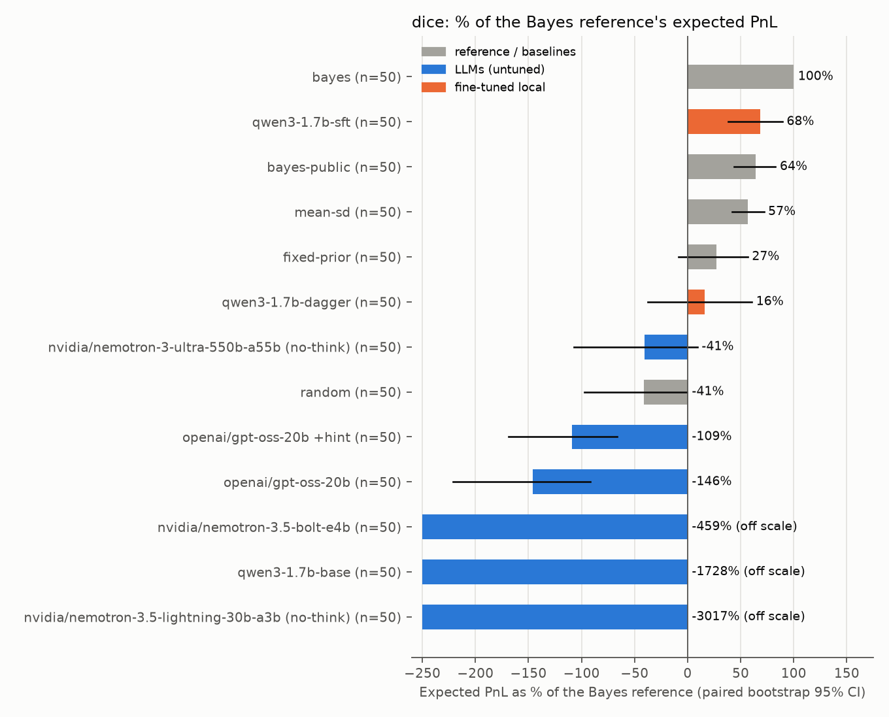
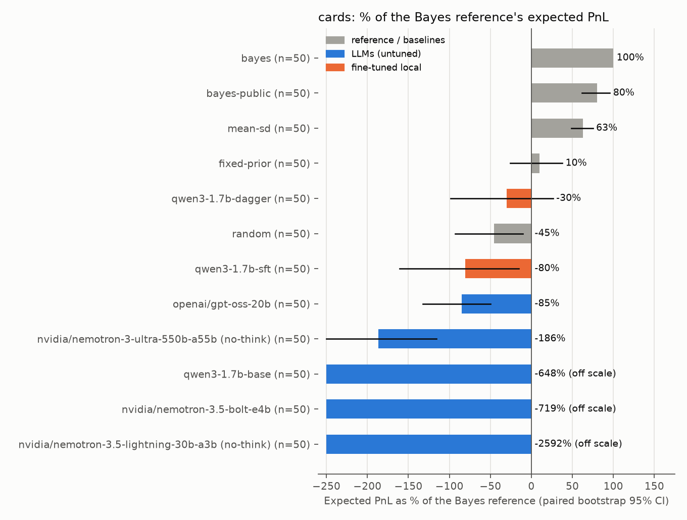

# MakeMarketBench

**Can LLMs make markets under adverse selection?** MakeMarketBench turns the
classic trading-interview game "make me a market" into a scored benchmark. A
model quotes a bid and an ask (price and size) on a hidden value while
information is revealed round by round. An informed counterparty picks off
mispriced quotes and noise traders pay the spread. Every decision is compared
with an exact Bayesian reference dealer.

The repository contains:

- a **C++20 limit order book** (price-time priority) exposed to Python with
  pybind11, plus a pure-Python reference implementation. Parity is tested on
  randomised event streams, and both are benchmarked;
- **two games** with exact posteriors: a dice sum, and a card sum with hints;
- a **Bayes reference quoter** and naive baselines, with **scoring** that
  separates the edge earned from noise traders from the cost of adverse
  selection;
- an **LLM harness** for any OpenAI-compatible endpoint, with strict JSON
  quotes, one repair retry, backoff and on-disk caching;
- **training code**: local MLX LoRA SFT and a DAgger round on Apple silicon
  (run, with real before/after numbers), plus an Unsloth + TRL GRPO Kaggle
  kernel whose reward is the edge relative to the Bayes player (GPU run
  pending).

Repository name note: `quotebench` is already used by unrelated LLM benchmarks
(e.g. LeonardNJU/quoteBench, about shell quoting), so this project is called
MakeMarketBench.

## Why market making is a good probe

Quoting a two-sided market is a compact test of reasoning under uncertainty,
and a single number scores it: expected profit. A good dealer has to do
four things:

1. **Inference.** Compute a posterior for V from the public information
   (convolutions of dice, sampling without replacement, conditioning on
   hints).
2. **Adverse selection.** A fill is information. If you get lifted, V is
   more likely above your ask. The spread must cover the expected loss to
   informed traders (Glosten and Milgrom, 1985).
3. **Price/size trade-off.** Wider quotes lose noise flow, and larger sizes
   lose more to the informed trader. The optimum is interior and depends on
   the posterior's shape, not only its mean.
4. **Learning from your own fills.** The reference updates its posterior
   from the fills it observes. A dealer that ignores this leaves a measurable
   amount of edge on the table.

LLMs often answer "what is E[V]?" correctly but have no instinct for points
2 to 4. The benchmark measures this gap directly.

## Games

All randomness (V, reveals, counterparties) is a deterministic function of the
episode seed. Every dealer therefore faces the same counterparties (common
random numbers), and comparisons are paired by seed.

**Market mechanics (both games).** There are 6 rounds. In each round the
dealer posts `{"bid", "bid_size", "ask", "ask_size"}`: prices on a 0.1 tick,
sizes 0-10, and the bid strictly below the ask. The quote rests in the order
book for that round only. Exactly one counterparty then arrives and sends an
IOC order:

- with probability 30% an **informed trader** who knows V: they buy the whole
  ask size if V > ask, or sell the whole bid size if V < bid;
- otherwise a **noise trader** with valuation u = M + e, where M is
  E[V | public info] and e ~ N(0, s^2). If u > M they buy D ~ U{1..5} units
  at any price up to u; otherwise they sell D units at any price down to u.

Inventory carries over and is settled at V. The model is told all of these
rules, including the probabilities.

**Game 1: dice.** V is the sum of 8 hidden d6. One die is revealed before
each of rounds 2-6, and 3 dice stay hidden. Noise s = 4.

**Game 2: cards.** V is the sum of 5 cards drawn without replacement from a
52-card deck (A=1 ... K=13). Before rounds 2-6 the public sees, in order: a
card, a hint, a card, a hint, a card. Hints are true statements about the
whole hand, drawn from these templates:

- exactly k face cards;
- the highest card;
- the lowest card;
- the parity of V;
- the number of cards of 5 or lower;
- whether there is a pair.

The exact posterior comes from enumerating the rank multisets of the unseen
cards, and is checked against brute force in the tests. Noise s = 6.

**Game 3 (Figgie-style multi-agent table)** is not implemented. The order
book already supports multiple owners with owner-checked cancellation, which
is what such a table needs.

## Reference dealer and baselines

- **bayes**: the exact posterior over V from the public information *and* from
  the dealer's own fills. The fill likelihood mixes the informed and noise
  components in closed form. The dealer then quotes the risk-neutral
  one-round optimum, found by grid search over every price tick and size for
  each side. Because exactly one counterparty arrives per round, the two sides
  decouple. This is *myopically* optimal: it ignores the information value of
  a quote, so it is a strong reference, not a proven upper bound.
- **bayes-public**: the same, but it ignores its fills (an ablation).
- **mean-sd**: quotes the exact public posterior mean ± 1 sd, with size 3.
- **fixed-prior**: quotes the prior mean ± 1 prior sd, with size 3, and never
  updates.
- **random**: uniform prices within 2 prior sd and uniform sizes.

## Scoring

The headline number is **% of Bayes edge**: 100 × mean E[PnL] of the
dealer / mean E[PnL] of the reference, over the same seeds. The 95% CI comes
from a paired bootstrap over episodes (10,000 resamples).

E[PnL] is the per-round expected profit given the true V and the posted
quote, with the counterparty draw integrated out in closed form, summed over
rounds. This is a Rao-Blackwellised estimator of realised PnL: it has the same
expectation and much lower variance. The test suite checks the closed form
against Monte Carlo runs through the matching engine. Realised PnL from the
engine is reported as well.

| Metric | Meaning |
|---|---|
| Noise edge / Adverse cost | Expected PnL earned from noise traders / lost to informed traders, per episode |
| Regret / round | Expected PnL of the reference quote minus the dealer's quote, under the exact posterior at the dealer's own state. CI is clustered by episode. |
| Spread / optimal | Median ratio of the quoted spread to the reference spread at the same state |
| Mid error | Mean absolute distance between the quote midpoint and the posterior mean |
| V in quote, size, abs(final position), realised PnL sd | Calibration and inventory-risk descriptors (in `results/leaderboard_*.md`) |
| Invalid answers | Share of rounds whose first answer failed parsing or validation. After one failed repair retry the round is played with no quote. |

## Leaderboard

Seeds 0-49 (50 episodes × 6 rounds per dealer and game). All models were
called on the free NVIDIA NIM endpoint at temperature 0.3, with at most 4096
output tokens and at most 2 requests in flight. `gpt-oss-20b` used
`reasoning_effort=low`: at the default effort it often spent all 4096 tokens
reasoning without answering. Raw episodes, including every model answer, are
in `results/raw/<game>/*.jsonl`.

### Game 1: dice

<!-- TABLE:dice -->
| Dealer | N | % of Bayes edge [95% CI] | E[PnL] / episode [95% CI] | Regret / round | Spread / optimal | Mid error | Adverse cost | Invalid answers |
|---|---|---|---|---|---|---|---|---|
| bayes | 50 | 100 [100, 100] | 14.0 [11.4, 16.2] | 0.00 | 1.00 | 0.16 | 4.2 | 0% |
| bayes-public | 50 | 64 [44, 83] | 8.9 [6.1, 11.3] | 0.48 | 1.03 | 0.91 | 6.0 | 0% |
| mean-sd | 50 | 57 [42, 72] | 8.0 [5.9, 9.7] | 0.67 | 0.98 | 0.92 | 4.7 | 0% |
| fixed-prior | 50 | 27 [-9, 57] | 3.8 [-1.2, 8.1] | 1.37 | 1.19 | 1.88 | 4.7 | 0% |
| random | 50 | -41 [-97, -1] | -5.7 [-12.5, -0.1] | 2.76 | 1.22 | 2.59 | 11.2 | 0% |
| openai/gpt-oss-20b | 50 | -146 [-221, -91] | -20.4 [-27.5, -13.9] | 5.28 | 0.22 | 3.26 | 23.4 | 8% |
<!-- /TABLE:dice -->



### Game 2: cards

<!-- TABLE:cards -->
| Dealer | N | % of Bayes edge [95% CI] | E[PnL] / episode [95% CI] | Regret / round | Spread / optimal | Mid error | Adverse cost | Invalid answers |
|---|---|---|---|---|---|---|---|---|
| bayes | 50 | 100 [100, 100] | 20.0 [17.2, 22.5] | 0.00 | 1.00 | 0.28 | 4.8 | 0% |
| bayes-public | 50 | 80 [62, 96] | 16.1 [12.1, 19.3] | 0.52 | 1.02 | 1.25 | 6.0 | 0% |
| mean-sd | 50 | 63 [49, 75] | 12.6 [9.5, 15.1] | 1.08 | 0.90 | 1.17 | 5.2 | 0% |
| fixed-prior | 50 | 10 [-26, 38] | 2.0 [-4.7, 8.1] | 2.67 | 1.32 | 3.86 | 7.0 | 0% |
| random | 50 | -45 [-93, -11] | -9.1 [-16.6, -2.3] | 5.18 | 1.37 | 4.88 | 14.9 | 0% |
<!-- /TABLE:cards -->



## Findings

_Filled in from the result files once all runs finish._

## Training a small model

<!-- TABLE:training -->
_Pending._
<!-- /TABLE:training -->

## Engine

<!-- TABLE:engine -->
| Implementation | Events / s | Time for 1M events |
|---|---|---|
| C++ engine, native loop (flat pool-based book) | 20.21 M | 49 ms |
| C++ v1 layout, native loop (std::map + std::list) | 8.79 M | 114 ms |
| C++ via pybind11, one call per stream (`replay`) | 7.75 M | 129 ms |
| C++ via pybind11, one Python call per event | 2.88 M | 347 ms |
| Pure-Python reference, one call per event | 1.54 M | 650 ms |
| Pure-Python reference, `replay` loop with checksum | 1.21 M | 824 ms |
<!-- /TABLE:engine -->

## Reproduce

```bash
python -m venv .venv && source .venv/bin/activate
pip install -e ".[dev,llm,plot]"          # builds the C++ extension (CMake >= 3.20, C++20 compiler)
pytest -q                                  # Python tests, incl. C++/Python parity
cmake -S . -B build/native -DMMB_BUILD_NATIVE=ON && cmake --build build/native && ./build/native/test_book

mmb eval --game dice --player bayes bayes-public mean-sd fixed-prior random
export NVIDIA_API_KEY=...                  # free key from build.nvidia.com
mmb eval --game dice --llm openai/gpt-oss-20b --extra-body '{"reasoning_effort": "low"}'
mmb score --game dice                      # writes results/leaderboard_dice.{json,md}
python scripts/make_figures.py && python scripts/update_readme_tables.py
python scripts/bench_engine.py             # engine throughput -> results/engine_bench.json
```

Any OpenAI-compatible server works, for example Ollama
(`--base-url http://localhost:11434/v1 --api-key-env NONE`), `mlx_lm.server` or vLLM.

## Limitations

## Related work

## Citation

```bibtex
@software{coquelet2026makemarketbench,
  author = {Coquelet, Nico},
  title  = {MakeMarketBench: Can LLMs Make Markets under Adverse Selection?},
  year   = {2026},
  url    = {https://github.com/ncoprod/makemarketbench}
}
```

## License

MIT
