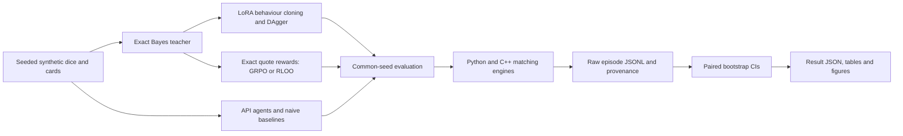

# MakeMarketBench

**Can language models quote profitable markets against an informed trader?**
The C++20 engine now processes **24.61M events/s**, up from **20.21M** on the
same seeded benchmark ([before](results/engine_bench.json),
[after](results/engine_bench_optimised.json)). A controlled, alternating comparison
confirms **20.14M → 20.81M events/s**, with an unchanged checksum and a
trial-corrected speedup interval above one
([200 paired measurements](results/engine_trials/inline_matching_confirmation.json)).

The research result is harder: **all four original NIM API models have negative
mean expected PnL in both games**. Qwen3-1.7B LoRA behaviour cloning reaches
**68% [38, 89]** of the Bayes dealer on dice, but **−80% [−161, −15]** on cards.
These are exploratory results on **50 episodes per player per game**,
not evidence of general trading ability
([dice](results/leaderboard_dice.json), [cards](results/leaderboard_cards.json)).

MakeMarketBench combines exact Bayesian posteriors, informed and noise flow,
a Python reference book, a C++ book with pybind11, cached LLM calls, and local
MLX / CUDA training. [ITERATIONS.md](ITERATIONS.md) records every optimisation
attempt, selection rule and failed run.



## What is measured

A dealer posts a bid, ask and sizes for a hidden terminal value. Public reveals
arrive between rounds; the dealer also observes its own fills. The informed
counterparty knows the value and trades against mispriced quotes. Noise traders
provide spread revenue. Dice uses sums of independent dice; cards uses sampling
without replacement and true hints about the hand. Exact rules and numerical
settings are in [protocol.json](results/protocol.json) and
[the game implementations](src/makemarket/games).

The reference dealer updates its exact posterior using public information and
fill likelihoods, then searches the price/size grid for the one-round optimum.
It is myopically optimal, not a proven upper bound on a full sequential policy.
`bayes-public` ignores fill information; `mean-sd`, `fixed-prior` and `random`
are simpler baselines. Figgie-lite provides an additional multi-agent sandbox;
its [historical results](results/leaderboard_figgie_seeds0-199.json) are noisy
and have no exact optimal-policy reference.

The headline score is `100 × mean expected PnL / mean Bayes expected PnL` on
common episode seeds. Expected PnL integrates out the arriving counterparty
conditional on the true value and quote: it is a lower-variance estimator of
realised PnL, which is also retained. CIs use episode-level paired bootstrap;
rounds from one episode are not independent observations. Invalid answers get
one repair attempt, then no quote. Regret, noise edge, adverse-selection cost,
spread calibration and inventory are retained in the result files.

## Historical leaderboard

These results use the original exploratory split. The figure and table retain
negative results and the mixed DAgger outcome; the fresh final evaluation is a
separate experiment. All intervals below are descriptive 95% intervals
([dice source](results/leaderboard_dice.json),
[cards source](results/leaderboard_cards.json)).

| Dealer | Dice: % Bayes [95% CI] | Cards: % Bayes [95% CI] |
|---|---:|---:|
| Bayes reference | 100 [100, 100] | 100 [100, 100] |
| Public-posterior Bayes | 64 [44, 83] | 80 [62, 96] |
| Mean ± standard deviation | 57 [42, 72] | 63 [49, 75] |
| Qwen3-1.7B base | −1728 [−2151, −1455] | −648 [−781, −558] |
| Qwen3-1.7B LoRA BC | 68 [38, 89] | −80 [−161, −15] |
| Qwen3-1.7B BC + DAgger | 16 [−37, 61] | −30 [−98, 26] |
| Nemotron-3-Ultra, thinking off | −41 [−107, 9] | −186 [−280, −116] |
| GPT-OSS-20B, low reasoning effort | −146 [−221, −91] | −85 [−132, −50] |
| Nemotron-3.5-Bolt | −459 [−612, −368] | −719 [−888, −603] |
| Nemotron-3.5-Lightning, thinking off | −3017 [−3759, −2550] | −2592 [−3146, −2194] |


Figure source: [leaderboard_dice.json](results/leaderboard_dice.json).
The [cards figure](docs/figures/leaderboard_cards.png) and
[complete metric tables](results/leaderboard_cards.md) show the harder inference
problem. The original API models generally quote too tightly and lose to
informed flow; behaviour cloning learns appropriate spreads but still makes
posterior errors after card hints. These are diagnoses of this environment,
not claims about financial-market profitability.

## Current training and evaluation

The new local target is **Qwen3.5-4B, MLX 4-bit, Apache-2.0**, pinned to an
[immutable model revision](results/licenses.json). Teacher targets come only
from the mathematical Bayes dealer. The complete
[token audit](results/training/qwen35_token_audit.json) verifies that training
answers follow the exact non-thinking inference prefix and fit the sequence
budget. The earlier Qwen3-1.7B baseline stays in the historical table. Its continuation
now reaches 800 total iterations ([training receipt](results/training/qwen17_sft800.json));
fresh policy evaluation is pending.

The registered recipe uses LoRA behaviour cloning with validation-loss
checkpoint selection and early stopping, followed by a larger on-policy DAgger
round and a small local RLOO-style reward trial. Numerical settings and split
boundaries are in [protocol.json](results/protocol.json); hypotheses, exact
commands and outcomes are in [ITERATIONS.md](ITERATIONS.md). Training and policy
validation are separate from the fresh test. The final target is
**200 episodes per player per game**, with paired bootstrap CIs and correction
for the API comparison family ([registered protocol](results/protocol.json)).
No new training score is claimed before its result file exists.

The first local 4B attempt was interrupted by the machine reboot. A subsequent
memory probe exceeded its guard before any verified optimiser update
([receipt](results/training/qwen35_memory_smoke.json)). A port of MLX-LM's
chunk-parallel training recurrence passes reference value/gradient checks;
its GPU memory probe is queued. These infrastructure attempts are not policy
improvements ([trial log](ITERATIONS.md)).

The private Kaggle script targets `unsloth/Qwen3.5-4B` with Unsloth and TRL
GRPO. It evaluates the warm start and trained policy inside Kaggle, writes raw
JSONL and leaderboard JSON, and records actual wall time and peak CUDA memory.
A compatible BC adapter can initialise it; adapters from a different model size
are rejected. The initial submission failed with HTTP 401
([exact failure](results/training/kaggle_attempt.json)). Official OAuth login
restored CLI access: the private checkpoint dataset is ready and the kernel
was accepted with a T4 requested, internet enabled and remote privacy verified
([retry receipt](results/training/kaggle_retry.json)). A separate one-update GRPO
smoke completed in **827.439 seconds**, peaking at **4.484 GB allocated VRAM**
([runtime](results/kaggle/smoke-v1/runtime.json)). Both completions were truncated
and received identical invalid-output rewards, so its update had zero learning
signal ([complete log](results/kaggle/smoke-v1/makemarketbench-grpo-qwen3-smoke.log)).
The full SFT/GRPO run remains pending. The local reward trial is explicitly
labelled RLOO-style.

NIM expansion retries GLM and DeepSeek with longer timeouts, enables Ultra
thinking, discovers Qwen3.8 availability and probes additional Qwen, Llama and
Mistral models. Calls run sequentially under a shared NIM slot; responses are
cached. Availability, failures and completed cohorts will be reported alongside
the new results. Both long-timeout retries ended in HTTP 504 after three requests
([failure receipts](results/expansion/protocol.json)); no scores are assigned.
The original [request protocol](results/llm_protocol.json) and
[endpoint failures](results/endpoint_check.json) remain available.

## Engine performance and correctness

The book uses flat price levels, pooled orders, intrusive FIFO links and an
open-addressed ID index. Profiling motivated inlining the matching loop. Two
pool/index experiments did not establish an improvement and were discarded
([complete trial log](ITERATIONS.md)). A reserved-ID lookup defect was fixed
and covered by Python/C++ stateful fuzzing. CI runs native ASan/UBSan builds.

| Measurement | Before → after | Evidence |
|---|---|---|
| Same original benchmark, native throughput | 20.21M → 24.61M events/s | [before](results/engine_bench.json), [after](results/engine_bench_optimised.json) |
| Controlled alternating comparison, median wall throughput | 20.14M → 20.81M events/s | [all paired samples](results/engine_trials/inline_matching_confirmation.json) |
| Median paired speedup | 1.0511; corrected CI [1.0318, 1.0694] | [three-configuration correction](results/engine_trials/inline_matching_confirmation.json) |
| Stream checksum | 6638620577960879557 → 6638620577960879557 | [before](results/engine_bench.json), [after](results/engine_bench_optimised.json) |

The historical benchmark and rerun occurred at different times on a shared
laptop. The alternating comparison controls this more closely. A ratio of
marginal medians differs from the median of paired ratios; both estimands are
reported. The benchmark measures an in-memory synthetic stream, not network or
exchange latency.

## Provenance

| Evidence | Configuration / identity | Traceability |
|---|---|---|
| [Historical game results](results/leaderboard_dice.json) | [raw episodes](results/raw), [API settings](results/llm_protocol.json), [training logs](results/training) | Original results predate full receipts; missing immutable revisions and exact commands are not reconstructed as facts |
| [Engine confirmation](results/engine_trials/inline_matching_confirmation.json) | Event-stream hash, old/new source hashes, compiler command, all timings, checksum | Producing commit and exact candidate patch retained |
| [Engine rerun](results/engine_bench_optimised.json) | Exact command, seed, source/binary hashes, environment | `provenance.git_commit` and working-diff hash |
| [Completed 1.7B continuation](results/training/qwen17_sft800.json) | Exact launch, data/base/adapter hashes, 800 total iterations | Post-run receipt explicitly identifies missing start-time diff and memory peak |
| [Teacher token audit](results/training/qwen35_token_audit.json) | Data hashes, pinned model revision, every split checked | Exact command and producing commit |
| [Kaggle failure](results/training/kaggle_attempt.json) | Private dataset/kernel settings and exact error | Failed submission is recorded as failed |
| [Kaggle retry](results/training/kaggle_retry.json) | OAuth recovery, private remote metadata, pinned model and submitted script hash | Accepted submission; execution measurements pending |
| [Licence verification](results/licenses.json) | HF revisions, upstream licence URLs and hashes | Verification evidence; model licence is distinct from endpoint terms |

New run receipts record the exact command, configuration, seeds, model revision
(or explicitly unavailable endpoint revision), source commit, adapter/data
hashes and measured resource use. Raw episode files support resumable evaluation.

## Reproduce

```bash
python3 -m venv .venv
source .venv/bin/activate
pip install -e '.[dev,llm,plot]'
pytest -q
cmake -S . -B build/native -DMMB_BUILD_NATIVE=ON -DCMAKE_BUILD_TYPE=Release
cmake --build build/native -j 2
ctest --test-dir build/native --output-on-failure
python scripts/bench_engine.py --out runs/engine_reproduction.json
python scripts/compare_engine.py --pairs 200 --out runs/engine_comparison.json
mmb eval --game dice --player bayes bayes-public mean-sd fixed-prior random
```

Load `NVIDIA_API_KEY` through your environment; never put it in commands or files.
For the shared resource limits, use the lock wrapper:

```bash
# CPU references can run before acquiring the heavy-ML lock:
mmb eval --game cards --seeds 200-399 --player bayes bayes-public mean-sd fixed-prior random \
  --results-dir runs/final
bash scripts/with_resource.sh nim python scripts/expand_nim.py
pip install mlx-lm transformers
python train/make_sft_data.py
bash scripts/with_resource.sh heavy-ml python train/mlx_train.py \
  --model mlx-community/Qwen3.5-4B-MLX-4bit \
  --revision 32f3e8ecf65426fc3306969496342d504bfa13f3 \
  --out train/runs/qwen35-sft --result runs/qwen35-sft.json
python train/build_kaggle_kernel.py
kaggle kernels push -p train/kaggle --accelerator NvidiaTeslaT4
# Poll status no more often than every ten minutes, then pull completed outputs:
kaggle kernels status nicolascoquelet/makemarketbench-grpo-qwen3
kaggle kernels output nicolascoquelet/makemarketbench-grpo-qwen3 -p runs/kaggle_output
```

For a local model path, use the snapshot downloaded at the recorded revision;
for a Hugging Face ID, `--revision` pins the download. Keep Kaggle datasets and the
kernel private. Long jobs write ignored `runs/` logs and save checkpoints.

## Limitations and licences

The games are synthetic, the informed trader has perfect information, the
reference is myopic, and inventory risk is reported without a penalty.
Historical samples are small and already influenced development. Greedy local
evaluation and stochastic API sampling have different decoding policies.
Endpoint deployments can drift even when model names do not; cached transcripts
preserve the responses actually scored. Figgie-lite is an exploratory sandbox.

Code and synthetic data are MIT, copyright Nicolas Coquelet. See
[THIRD_PARTY_NOTICES.md](THIRD_PARTY_NOTICES.md) for exact model and dependency
licences. **The historical MiniMax probe uses a model whose community licence
has a default non-commercial grant and conditional commercial terms.** NVIDIA
API Trial terms also restrict use and redistribution of generated content;
private audit transcripts require a terms review before public release. The
code licence does not relicense model weights or endpoint outputs.

## Prior art

- [Glosten and Milgrom (1985)](https://doi.org/10.1016/0304-405X(85)90044-3)
  and [Kyle (1985)](https://doi.org/10.2307/1913210): adverse selection and
  informed trading. [Avellaneda and Stoikov (2008)](https://doi.org/10.1080/14697680701381228)
  studies inventory-aware market making.
- [Market-Bench](https://arxiv.org/abs/2512.12264) evaluates executable trading
  backtesters; [LiveTradeBench](https://arxiv.org/abs/2511.03628) evaluates live
  portfolio decisions. [Experimental-finance LLM agents](https://arxiv.org/abs/2502.15800),
  [Cattle Trade](https://arxiv.org/abs/2605.14537), and
  [RL market makers under adverse selection](https://arxiv.org/abs/2510.27334)
  cover related settings.
- [Figgie](https://www.figgie.com/how-to-play) and the
  [Cornell FiggieBot](https://github.com/CornellDataScience/FiggieBot) motivate
  the separate sandbox; no bot implementation is copied.
- [DAgger](https://proceedings.mlr.press/v15/ross11a.html) motivates on-policy
  imitation; [DeepSeekMath](https://arxiv.org/abs/2402.03300) introduces GRPO.
- The unrelated [quoteBench](https://github.com/LeonardNJU/quoteBench) evaluates
  shell quoting. The repository uses MakeMarketBench to avoid that name collision.

Cite this software using [CITATION.cff](CITATION.cff).
