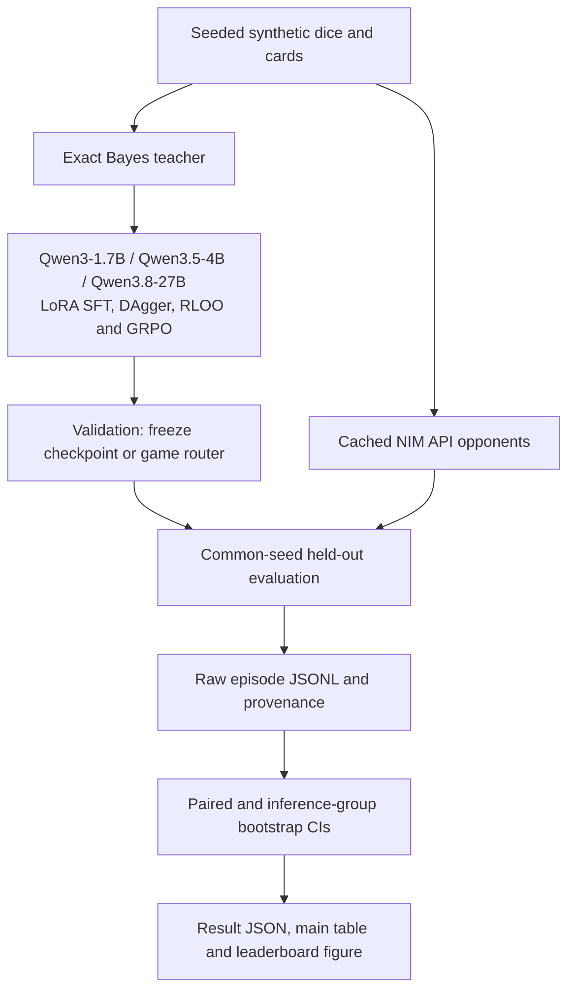
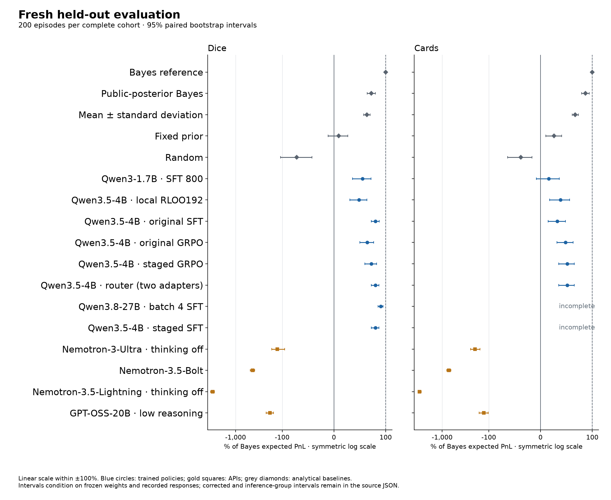

# MakeMarketBench

**TL;DR:** **Qwen3.8-27B SFT** reaches **90.4% [85.2, 94.8]** of Bayes
expected PnL on the fresh **dice test, n=200**
([score](results/final/scores/qwen3.8-27b-batch4-sft.json)). Its cards test
stops at **192/200 episodes, unscored**; cards validation is
**77.5% [61.0, 91.1], n=100**
([validation](results/training/qwen38_selection.json),
[terminal continuation receipt](results/training/qwen38_test_finish_completion.json)).
A validation-selected **Qwen3.5-4B SFT/GRPO game router** reaches
**80.2% [72.5, 87.2]** of Bayes expected PnL on dice and
**51.6% [35.3, 65.5]** on cards in the fresh **test, n=200/game**.
All four original API LLMs lose in both games
([frozen test scores](results/final/summary.json)). These are synthetic
market-making results, conditional on frozen weights and recorded responses.

The C++20 matching engine improves from **20.14M to 20.81M events/s** in a
controlled alternating comparison, with identical checksums; median paired
speedup is **1.0511 [1.0318, 1.0694]** after trial correction
([200 paired measurements](results/engine_trials/inline_matching_confirmation.json)).

MakeMarketBench combines exact Bayesian posteriors, informed and noise flow,
a Python reference book, a C++ book with pybind11, cached LLM calls, and local
MLX / CUDA training. [ITERATIONS.md](ITERATIONS.md) records every optimisation
attempt, selection rule and failed run.



## What is measured

A dealer quotes a hidden terminal value, observes public reveals and its own
fills, and faces an informed trader who knows that value. Noise flow supplies
spread revenue. Dice uses sums of dice; cards uses sampling without replacement
and true hints ([rules and settings](results/protocol.json),
[implementations](src/makemarket/games)).

The Bayes dealer updates its exact posterior from public information and fill
likelihoods, then searches the price/size grid. It is myopically optimal, rather
than a proven upper bound on a full sequential policy. The headline score is
`100 × mean expected PnL / mean Bayes expected PnL` on common episode seeds.
Expected PnL integrates out the arriving counterparty; realised PnL is also saved.
Invalid answers receive one repair attempt, then no quote. Bootstrap sampling
uses episodes, with a separate whole-inference-group check for batched policies.

## Fresh held-out results

Every **TEST** cohort uses common held-out seeds 200–399, **n=200/game** when
complete. The explicitly labelled **VAL** row uses seeds 80000–80099,
**n=100/game** and selected the frozen 27B policy. Partial games remain unscored.
The table shows percentage of Bayes expected PnL and marginal 95% paired
bootstrap intervals. Every dealer links to its complete score JSON; the
eleven-candidate correction and inference-group checks are retained in the
[report manifest](results/final/summary.json) and [protocol](results/protocol.json).

| Dealer / source | Split (n/game) | Dice: % Bayes [95% CI] | Cards: % Bayes [95% CI] |
|---|---|---:|---:|
| [Bayes reference](results/final/scores/qwen3-1.7b-sft800.json) | TEST (200) | 100.0 [100.0, 100.0] | 100.0 [100.0, 100.0] |
| [Qwen3-1.7B · SFT800](results/final/scores/qwen3-1.7b-sft800.json) | TEST (200) | 55.1 [36.1, 71.5] | 16.0 [-7.9, 36.2] |
| [Qwen3.5-4B · original SFT](results/final/scores/qwen3.5-4b-grpo-warmstart.json) | TEST (200) | 80.2 [72.3, 87.3] | 32.6 [14.7, 48.5] |
| [Qwen3.5-4B · original GRPO](results/final/scores/qwen3.5-4b-grpo.json) | TEST (200) | 64.5 [50.1, 76.6] | 48.4 [32.0, 62.8] |
| [Qwen3.5-4B · local RLOO192](results/final/scores/qwen3.5-4b-rloo192.json) | TEST (200) | 48.4 [30.9, 63.6] | 38.5 [17.8, 56.4] |
| [Qwen3.5-4B · staged SFT](results/final/scores/qwen3.5-4b-staged-sft-dice-only.json) | TEST (200 dice; 100 cards) | 80.2 [72.5, 87.2] | incomplete; unscored |
| [Qwen3.5-4B · staged GRPO](results/final/scores/qwen3.5-4b-staged-grpo.json) | TEST (200) | 72.0 [59.8, 82.6] | 51.6 [35.3, 65.5] |
| [Qwen3.5-4B · game router (two adapters)](results/final/scores/qwen3.5-4b-staged-routed.json) | TEST (200) | 80.2 [72.5, 87.2] | 51.6 [35.3, 65.5] |
| [Qwen3.8-27B · selected SFT, batch four](results/final/scores/qwen3.8-27b-batch4-sft.json) | TEST (200 dice; 192 cards) | 90.4 [85.2, 94.8] | 192/200; unscored |
| [Qwen3.8-27B · selected SFT, batch four](results/training/qwen38_selection.json) | VAL (100) | 94.5 [87.3, 101.0] | 77.5 [61.0, 91.1] |
| [Nemotron-3-Ultra · thinking off](results/final/scores/qwen3-1.7b-sft800.json) | TEST (200) | -127.4 [-167.1, -95.3] | -197.4 [-246.4, -154.7] |
| [GPT-OSS-20B · low reasoning](results/final/scores/qwen3-1.7b-sft800.json) | TEST (200) | -183.7 [-222.1, -152.4] | -128.5 [-160.6, -101.9] |
| [Nemotron-3.5-Bolt](results/final/scores/qwen3-1.7b-sft800.json) | TEST (200) | -430.6 [-485.7, -386.9] | -717.0 [-800.6, -649.8] |
| [Nemotron-3.5-Lightning · thinking off](results/final/scores/qwen3-1.7b-sft800.json) | TEST (200) | -3108.5 [-3439.6, -2843.2] | -3047.8 [-3320.4, -2824.5] |



The game router uses one base model and two frozen adapters, selected on
validation before inspecting test scores. It is a separate candidate from a
single checkpoint. Partial staged-SFT cards and optional API acquisitions stay
unscored. The three reported 27B ERROR jobs reached their registered script
wall deadlines; logs and recovered episode counts are retained
([error receipts](results/training/qwen38_terminal_errors.json)). The single bounded continuation fails before inference because Kaggle omits the
ERROR source kernel from its saved input mounts; prefix lookup raises
`AssertionError: []`. No new episodes are acquired. The original 192 cards
remain unscored, and no second rerun is submitted
([plan](results/training/qwen38_test_finish_plan.json),
[downloaded failure](results/training/qwen38_test_finish_completion.json)). All original API models have negative mean expected PnL in both games,
with each marginal 95% interval below zero. This concerns the synthetic informed
trader in this benchmark.

The [original exploratory results](docs/training_history.md#original-exploratory-leaderboard)
used 50 episodes and influenced development. They are retained separately;
differences from the fresh test are not estimates of a causal training gain.

## Training and selection

Training seeds, validation seeds and test seeds are disjoint. Both the local
and newest-family policy choices freeze before opening any new aggregate test
score ([protocol](results/protocol.json)). The final family counts eleven
candidates, including unavailable and unselected trials. Every complete cohort
is reported; partial games stay unscored. The router meets the registered mean
dice threshold and both episode and inference-group corrected cards positivity
checks. The original SFT cards corrected bound is close to zero; the uniform
[tenfold bootstrap precision audit](results/final/bootstrap_precision.json)
retains primary verdicts and exposes that numerical sensitivity.

- **Qwen3-1.7B:** the earlier behaviour-cloning baseline reaches 800 total
  iterations through a 500-iteration continuation with restarted optimizer
  ([receipt](results/training/qwen17_sft800.json)). Its fresh cards interval
  includes zero; the historical negative result remains in the training history.
- **Local Qwen3.5-4B:** full SFT, a larger on-policy DAgger round and four RLOO
  budgets are complete. Seven validation trials select RLOO192. Two successive
  extensions fail the registered improvement rule, ending that recipe
  ([selection](results/training/selection.json),
  [stopping assessment](results/training/qwen35_rloo384_iteration.json)). It
  scores 48.4% [30.9, 63.6] on fresh dice, below target
  ([test](results/final/scores/qwen3.5-4b-rloo192.json)).
- **CUDA Qwen3.5-4B:** the staged pipeline completes 150 SFT and 300 GRPO
  updates in 17,983.032 seconds, peaking at 6.327 GB allocated VRAM
  ([runtime](results/kaggle/staged-v1/runtime.json)). Validation selects SFT
  for dice and GRPO for cards; that two-adapter router is frozen before test
  ([rule](results/training/staged_routing_plan.json)). The original single-SFT,
  original-GRPO and staged-GRPO results are retained as separate rows.
- **Newest Qwen:** the official catalogue checked on October 31 identifies Qwen3.8
  as the newest general-purpose family; its smallest model is 27B and Apache-2.0
  ([catalogue](results/training/qwen_latest_recheck_20261031.json),
  [pinned licences](results/training/qwen38_before_batch_access.json)). Its
  4-bit checkpoint occupies 20.81 GiB before activations, against 29.12 GiB
  across two T4s. It exceeds one T4's capacity; measured model-parallel QLoRA
  fits two ([memory arithmetic](results/training/qwen38_quantized.json)).
  A private saved batch completes 800 SFT + 96 GRPO updates in 17,901.346
  seconds, peaking at 12.238 / 12.261 GB allocated VRAM
  ([primary](results/training/qwen38_seed0_completion.json)). Periodic saved
  checkpoints include optimizer and RNG state. Seed one also completes;
  its poorer SFT validation is retained and cannot replace the preregistered
  primary seed ([replication](results/training/qwen38_seed1_completion.json),
  [paired validation contrast](results/validation/qwen38_sft_seed_dice.json)).
  Batch-four SFT is selected with an exact max-min bound: GRPO's complete dice
  score caps its selection score below SFT's, regardless of its missing cards.
  This explicitly departs from the planned both-cards completion gate;
  partial cards remain unscored, and the certificate proves the selection
  outcome rather than statistical superiority
  ([certificate](results/training/qwen38_selection_bound_plan.json),
  [frozen choice](results/training/qwen38_selection.json)).
- **NIM APIs:** all four original models complete 200 episodes/game
  ([canonical checks](results/expansion/primary_api_canonical.json)). Longer
  GLM/DeepSeek retries, thinking-enabled Ultra and extra Llama/Mistral/Gemma
  coverage retain endpoint failures, timeouts, reasoning-budget failures and
  partial cohorts ([receipts](results/expansion)). Sequential clients hold one
  of two shared slots and cache every response.

The [full training history](docs/training_history.md) retains all budgets,
losses, failed experiments, batching sensitivity and negative outcomes.
The [GPU ledger](results/training/kaggle_budget.json) distinguishes official
account billing from measured script runtime and session caps. The actual weekly
reset reported by Kaggle is November 7; assumed calendar resets are not used to
allocate runs. Final API acquisition closes at the registered cutoff; Llama-90B
retains 173 dice / 92 cards episodes, unscored
([receipt](results/expansion/llama_duplicate_retry_completion.json)).

## Engine performance and correctness

The book uses flat price levels, pooled orders, intrusive FIFO links and an
open-addressed ID index. Profiling motivated inlining the matching loop. Two
pool/index experiments did not establish an improvement and were discarded
([complete trial log](ITERATIONS.md)). A reserved-ID lookup defect was fixed
and covered by Python/C++ stateful fuzzing. CI runs native ASan/UBSan builds.

| Measurement | Before → after | Evidence |
|---|---|---|
| Same original benchmark, native throughput | 20.21M → 24.61M events/s | [before](results/engine_bench.json), [after](results/engine_bench_optimised.json) |
| Controlled alternating comparison, median wall throughput | 20.14M → 20.81M events/s | [all paired samples](results/engine_trials/inline_matching_confirmation.json) |
| Median paired speedup | 1.0511; corrected CI [1.0318, 1.0694] | [three-configuration correction](results/engine_trials/inline_matching_confirmation.json) |
| Stream checksum | 6638620577960879557 → 6638620577960879557 | [before](results/engine_bench.json), [after](results/engine_bench_optimised.json) |

The historical benchmark and rerun occurred at different times on a shared
laptop. The alternating comparison controls this more closely. A ratio of
marginal medians differs from the median of paired ratios; both estimands are
reported. All four circular-block bootstrap intervals also remain above one
after correcting for the engine variants and block lengths
([timing-dependence check](results/engine_trials/inline_matching_block_intervals.json)).
The benchmark measures an in-memory synthetic stream, not network or
exchange latency.

Current local verification passes **149 Python tests**
([local CI receipt](results/ci_local_final.json)), native Release and
ASan/UBSan checks. Run `bash scripts/ci_local.sh`; the installed pre-push hook
requires these checks. Hosted Linux CI passes on Python 3.10 and 3.12, including native ASan/UBSan.
The resumed workflow revealed an import-path issue, fixed by matching the
local `python -m pytest` entrypoint
([hosted receipt](results/ci_hosted_final.json)).

## Provenance

| Evidence | Configuration / identity | Traceability |
|---|---|---|
| [Cached replay proof](results/final/cached_replay_check.json) | Fresh tracked-file checkout, clean Python environment, no weights or API credentials | Seven policies and partial dice reproduce games/target objects exactly |
| [Fresh scores](results/final/summary.json) | Frozen selections, every scoring command, common test seeds and raw hashes | Producing commits and full score files; numerical replay needs no private weights |
| [Selected 27B test](results/training/qwen38_test_finish_completion.json) | Exact adapter, source, canonical game checks and wrapper runtime | Original deadline-stopped download retained unchanged; hard-kill leaves only a stale worker VRAM snapshot |
| [Historical game results](results/leaderboard_dice.json) | [raw episodes](results/raw), [API settings](results/llm_protocol.json), [training logs](results/training) | Original results predate full receipts; missing immutable revisions and exact commands are not reconstructed as facts |
| [Engine confirmation](results/engine_trials/inline_matching_confirmation.json) | Event-stream hash, old/new source hashes, compiler command, all timings, checksum | Producing commit and exact candidate patch retained |
| [Engine rerun](results/engine_bench_optimised.json) | Exact command, seed, source/binary hashes, environment | `provenance.git_commit` and working-diff hash |
| [Completed 1.7B continuation](results/training/qwen17_sft800.json) | Exact launch, data/base/adapter hashes, 800 total iterations | Post-run receipt explicitly identifies missing start-time diff and memory peak |
| [Game comparability](results/final/game_comparability.json) | Complete CUDA, MLX and API test cohorts checked against canonical seeded games | Seed, hidden value, six rounds and public reveals verified without inspecting model scores |
| [Teacher token audit](results/training/qwen35_token_audit.json) | Data hashes, pinned model revision, every split checked | Exact command and producing commit |
| [Kaggle failure](results/training/kaggle_attempt.json) | Private dataset/kernel settings and exact error | Failed submission is recorded as failed |
| [Completed CUDA training](results/training/kaggle_staged_completion.json) | Pinned model, trainer configs, adapter hashes and downloaded runtime | SFT and GRPO complete; [test evaluation](results/training/kaggle_staged_final_completion.json) retains GRPO cohorts and failed SFT batching check |
| [Newest Qwen catalogue](results/training/qwen_latest_details.json) | Official HF model IDs, revisions and configs | Family and size selection, separate from policy quality |
| [GPU budget](results/training/kaggle_budget.json) | Official quota snapshots and per-session receipts | Script runtime and account billing kept distinct |
| [Licence verification](results/licenses.json) | HF revisions, upstream licence URLs and hashes | Verification evidence; model licence is distinct from endpoint terms |

New run receipts record the exact command, configuration, seeds, model revision
(or explicitly unavailable endpoint revision), source commit, adapter/data
hashes and measured resource use. Raw episode files support resumable evaluation.

## Reproduce

```bash
python3 -m venv .venv
source .venv/bin/activate
pip install -e '.[dev,llm,plot]'
bash scripts/ci_local.sh
git config core.hooksPath .githooks
python scripts/bench_engine.py --out runs/engine_reproduction.json
python scripts/compare_engine.py --pairs 200 --out runs/engine_comparison.json
mmb eval --game dice --player bayes bayes-public mean-sd fixed-prior random
# Rebuild the numeric report and figure from committed episodes, without weights:
python scripts/score_frozen_candidates.py
python scripts/check_bootstrap_precision.py
python scripts/plot_final.py
# Optional paper build (requires pandoc and tectonic):
python scripts/build_paper.py
```

Load `NVIDIA_API_KEY` through your environment; never put it in commands or files.
For the shared resource limits, use the lock wrapper:

```bash
# CPU references can run before acquiring the heavy-ML lock:
mmb eval --game cards --seeds 200-399 --player bayes bayes-public mean-sd fixed-prior random \
  --results-dir runs/final
bash scripts/with_resource.sh nim python scripts/expand_nim.py
pip install mlx-lm transformers
python train/make_sft_data.py
bash scripts/with_resource.sh heavy-ml python train/with_memory_guard.py \
  --result runs/qwen35-memory.json python train/mlx_train.py \
  --model mlx-community/Qwen3.5-4B-MLX-4bit \
  --revision 32f3e8ecf65426fc3306969496342d504bfa13f3 \
  --out train/runs/qwen35-sft --result runs/qwen35-sft.json \
  --answer-head-tokens 128 --pad-training-to 1025
```

For the newest-family saved batch, checkpoint resume and sealed evaluation, see
[the Qwen3.8 reproduction steps](docs/reproduce_qwen38.md).

For a local model path, use the snapshot downloaded at the recorded revision;
for a Hugging Face ID, `--revision` pins the download. Keep Kaggle datasets and the
kernel private. Long jobs write ignored `runs/` logs and save checkpoints.

## Limitations and licences

The games are synthetic, the informed trader has perfect information, the
reference is myopic, and inventory risk is reported without a penalty.
Historical samples are small and already influenced development. Greedy local
evaluation and stochastic API sampling have different decoding policies.
Endpoint deployments can drift even when model names do not; cached transcripts
preserve the responses actually scored. Figgie-lite is an exploratory sandbox.
Bootstrap intervals quantify episode variation conditional on each frozen
checkpoint and the recorded API responses. Training-seed variation and fresh
API decoding draws require separate replications. Batched CUDA cohorts also
receive a complete-inference-batch bootstrap sensitivity check; target
positivity must pass both resampling methods ([protocol](results/protocol.json)).
This check remains conditional on the recorded response cache. Backend
comparisons vary quantizers, adapter settings and training recipes.
The reward trials sample new quotes on states visited by the Bayes teacher;
their training contexts do not follow the learned policy's own fills. DAgger
collects those on-policy states. This state-distribution gap can limit transfer
from GRPO or RLOO training rewards to complete-game performance.

Code and synthetic data are MIT, copyright Nicolas Coquelet. See
[THIRD_PARTY_NOTICES.md](THIRD_PARTY_NOTICES.md) for exact model and dependency
licences. **The historical MiniMax probe uses a model whose community licence
has a default non-commercial grant and conditional commercial terms.** NVIDIA
API Trial terms also restrict use and redistribution of generated content;
private audit transcripts require a terms review before public release. The
code licence does not relicense model weights or endpoint outputs.

## Prior art

- [Glosten and Milgrom (1985)](https://doi.org/10.1016/0304-405X(85)90044-3)
  and [Kyle (1985)](https://doi.org/10.2307/1913210): adverse selection and
  informed trading. [Avellaneda and Stoikov (2008)](https://doi.org/10.1080/14697680701381228)
  studies inventory-aware market making.
- [Market-Bench](https://arxiv.org/abs/2512.12264) evaluates executable trading
  backtesters; [LiveTradeBench](https://arxiv.org/abs/2511.03628) evaluates live
  portfolio decisions. [Experimental-finance LLM agents](https://arxiv.org/abs/2502.15800),
  [Cattle Trade](https://arxiv.org/abs/2605.14537), and
  [RL market makers under adverse selection](https://arxiv.org/abs/2510.27334)
  cover related settings.
- [Figgie](https://www.figgie.com/how-to-play) and the
  [Cornell FiggieBot](https://github.com/CornellDataScience/FiggieBot) motivate
  the separate sandbox; no bot implementation is copied.
- [DAgger](https://proceedings.mlr.press/v15/ross11a.html) motivates on-policy
  imitation; [DeepSeekMath](https://arxiv.org/abs/2402.03300) introduces GRPO.
- The unrelated [quoteBench](https://github.com/LeonardNJU/quoteBench) evaluates
  shell quoting. The repository uses MakeMarketBench to avoid that name collision.

The [research note](paper/main.pdf) is generated from the final result files;
its [source](paper/main.md), [builder](scripts/build_paper.py) and
[build receipt](results/final/paper.json) are retained. No earlier paper source
was present in this checkout.

Cite this software using [CITATION.cff](CITATION.cff).
