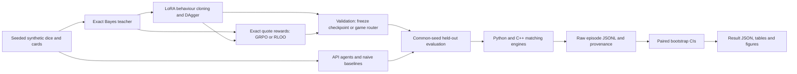

# MakeMarketBench

**TL;DR:** A fast matching engine and a hard, synthetic market-making benchmark.
The newest model, Qwen3.8-27B, is prepared as a private saved batch for the
next GPU allocation; its lost draft supplies no verified final policy result
([registered rerun](results/training/qwen38_round3_batch_plan.json)).

**Can language models quote profitable markets against an informed trader?**
The C++20 engine now processes **24.61M events/s**, up from **20.21M** on the
same seeded benchmark ([before](results/engine_bench.json),
[after](results/engine_bench_optimised.json)). A controlled, alternating comparison
confirms **20.14M → 20.81M events/s**, with an unchanged checksum and a
trial-corrected speedup interval above one
([200 paired measurements](results/engine_trials/inline_matching_confirmation.json)).

The research result is harder: **all four original NIM API models have negative
mean expected PnL in both games**. Qwen3-1.7B LoRA behaviour cloning reaches
**68% [38, 89]** of the Bayes dealer on dice, but **−80% [−161, −15]** on cards.
These are exploratory results on **50 episodes per player per game**,
not evidence of general trading ability
([dice](results/leaderboard_dice.json), [cards](results/leaderboard_cards.json)).

MakeMarketBench combines exact Bayesian posteriors, informed and noise flow,
a Python reference book, a C++ book with pybind11, cached LLM calls, and local
MLX / CUDA training. [ITERATIONS.md](ITERATIONS.md) records every optimisation
attempt, selection rule and failed run.



## What is measured

A dealer posts a bid, ask and sizes for a hidden terminal value. Public reveals
arrive between rounds; the dealer also observes its own fills. The informed
counterparty knows the value and trades against mispriced quotes. Noise traders
provide spread revenue. Dice uses sums of independent dice; cards uses sampling
without replacement and true hints about the hand. Exact rules and numerical
settings are in [protocol.json](results/protocol.json) and
[the game implementations](src/makemarket/games).

The reference dealer updates its exact posterior using public information and
fill likelihoods, then searches the price/size grid for the one-round optimum.
It is myopically optimal, not a proven upper bound on a full sequential policy.
`bayes-public` ignores fill information; `mean-sd`, `fixed-prior` and `random`
are simpler baselines. Figgie-lite provides an additional multi-agent sandbox;
its [historical results](results/leaderboard_figgie_seeds0-199.json) are noisy
and have no exact optimal-policy reference.

The headline score is `100 × mean expected PnL / mean Bayes expected PnL` on
common episode seeds. Expected PnL integrates out the arriving counterparty
conditional on the true value and quote: it is a lower-variance estimator of
realised PnL, which is also retained. CIs use episode-level paired bootstrap;
rounds from one episode are not independent observations. Invalid answers get
one repair attempt, then no quote. Regret, noise edge, adverse-selection cost,
spread calibration and inventory are retained in the result files.

## Historical leaderboard

These results use the original exploratory split. The figure and table retain
negative results and the mixed DAgger outcome; the fresh final evaluation is a
separate experiment. All intervals below are descriptive 95% intervals
([dice source](results/leaderboard_dice.json),
[cards source](results/leaderboard_cards.json)).

| Dealer | Dice: % Bayes [95% CI] | Cards: % Bayes [95% CI] |
|---|---:|---:|
| Bayes reference | 100 [100, 100] | 100 [100, 100] |
| Public-posterior Bayes | 64 [44, 83] | 80 [62, 96] |
| Mean ± standard deviation | 57 [42, 72] | 63 [49, 75] |
| Qwen3-1.7B base | −1728 [−2151, −1455] | −648 [−781, −558] |
| Qwen3-1.7B LoRA BC | 68 [38, 89] | −80 [−161, −15] |
| Qwen3-1.7B BC + DAgger | 16 [−37, 61] | −30 [−98, 26] |
| Nemotron-3-Ultra, thinking off | −41 [−107, 9] | −186 [−280, −116] |
| GPT-OSS-20B, low reasoning effort | −146 [−221, −91] | −85 [−132, −50] |
| Nemotron-3.5-Bolt | −459 [−612, −368] | −719 [−888, −603] |
| Nemotron-3.5-Lightning, thinking off | −3017 [−3759, −2550] | −2592 [−3146, −2194] |


Figure source: [leaderboard_dice.json](results/leaderboard_dice.json).
The [cards figure](docs/figures/leaderboard_cards.png) and
[complete metric tables](results/leaderboard_cards.md) show the harder inference
problem. The original API models generally quote too tightly and lose to
informed flow; behaviour cloning learns appropriate spreads but still makes
posterior errors after card hints. These are diagnoses of this environment,
not claims about financial-market profitability.

## Current training and evaluation

Training uses exact Bayes demonstrations, disjoint teacher/policy validation,
and a fresh 200-episode-per-game test. The registered recipes, seeds, selection
rule and nine-candidate correction are in [protocol.json](results/protocol.json).
Test scores do not select checkpoints or prompts. The earlier Qwen3-1.7B
baseline now completes 800 total iterations and both fresh test cohorts
([training](results/training/qwen17_sft800.json),
[cohorts](results/final/qwen17-sft800/cohorts.json)); its corrected comparison
waits for the remaining candidates and API cohorts.

**Local Qwen3.5-4B:** MLX 4-bit LoRA, followed by a larger DAgger round and a
small RLOO-style trial. The [token audit](results/training/qwen35_token_audit.json)
checks non-thinking prefixes and sequence limits. Earlier attempts stopped at
reboot or memory guards; all are retained in [ITERATIONS.md](ITERATIONS.md).
Projecting only answer positions preserves the full causal loss/gradients;
starting from the interrupted adapter, fixed training shapes complete
**800 microbatches / 400 optimizer updates** in
**14,021.710 seconds**. Full validation loss falls **2.113 → 0.280** on all
**480 examples**, with sampled physical footprint **6.713 GB**
([completed run, memory guard and adapter hash](results/training/qwen35_sft_completion.json)).
The completed 100-episode-per-game validation gives **23.1% [−4.2, 48.0]** of
Bayes on dice and **8.9% [−35.1, 42.7]** on cards
([complete cohorts and scores](results/validation/qwen35-sft/cohorts.json),
[numerical-rationale diagnosis](results/validation/qwen35-sft/dice_rationale_diagnosis.json)).
Teacher loss does not establish policy quality. Local heavy work holds the
shared ML lock. The larger DAgger continuation stops after **599 microbatches /
299 updates** without improving validation loss; its selected adapter is
byte-identical to SFT ([complete training outcome](results/training/qwen35_dagger_completion.json)).
Its completed 100-episode-per-game policy validation reproduces SFT exactly:
paired expected-PnL changes are zero in both games
([expanded contrast-family intervals](results/validation/qwen35-dagger/vs_sft.json),
[cohorts and identities](results/validation/qwen35-dagger/cohorts.json)).
The final local selection also checks the distinct last saved DAgger checkpoint
before opening the test ([registered validation amendment](results/training/qwen35_dagger_last_plan.json)).
That checkpoint reaches **37.1% [7.4, 60.6]** on dice and
**−39.7% [−92.0, 1.5]** on cards, with no format failures
([complete validation](results/validation/qwen35-dagger-last/cohorts.json),
[paired contrasts](results/validation/qwen35-dagger-last/vs_sft.json)).
The dice-only RLOO-style trial completes all 24 groups in 1,175.507 seconds
([runtime, memory and adapter identity](results/training/qwen35_rloo_completion.json)).
Validation rises to **48.7% of Bayes on dice** and **19.6% on cards**
([full cohorts and CIs](results/validation/qwen35-rloo/cohorts.json)). The paired
dice expected-PnL gain survives the expanded correction; the cards gain does
not ([all contrasts](results/validation/qwen35-rloo/vs_sft.json)). Fixed
96/192-group continuations are
[registered before selection or test](results/training/qwen35_rloo_extensions_plan.json).
The 96-group run finishes its 72 new groups in 3,952.699 seconds, with exact
history-prefix preservation and bounded checkpoint storage
([completion receipt](results/training/qwen35_rloo96_completion.json)). Its
complete validation reaches **66.3% [49.0, 80.6]** on dice and
**16.2% [−28.9, 50.0]** on cards
([cohorts](results/validation/qwen35-rloo96/cohorts.json)). The paired dice
increment over 24 groups survives the registered correction; the cards change
does not ([both contrasts](results/validation/qwen35-rloo96/vs_rloo.json)).
At 192 groups, validation reaches **70.4% [55.8, 83.2]** on dice and
**16.1% [−27.8, 48.8]** on cards
([complete cohorts](results/validation/qwen35-rloo192/cohorts.json)). This
increment misses the registered material-improvement criterion
([assessment](results/training/qwen35_rloo192_iteration.json)). The final
384-group continuation falls to **53.8% [34.3, 70.8]** on dice and
**19.7% [−20.7, 51.2]** on cards
([complete validation](results/validation/qwen35-rloo384/cohorts.json)).
Two consecutive iterations miss the registered improvement criterion, so this
local recipe stops ([assessment and diagnosis](results/training/qwen35_rloo384_iteration.json)).
The max-min rule freezes RLOO192 across all seven trials
([selection](results/training/selection.json)); all eighteen validation
contrasts count. Its fresh 200-episode-per-game test is collected without
opening scores while the newest-model selection remains pending.

**CUDA Qwen3.5-4B:** Unsloth QLoRA completes **150 SFT and 300 GRPO updates in
17,983.032 seconds**, peaking at **6.327 GB allocated VRAM** on its training T4
([runtime](results/kaggle/staged-v1/runtime.json),
[configs and checkpoint histories](results/training/kaggle_staged_completion.json)).
It saves both adapters before evaluation inside Kaggle; no local conversion
is required. Incompatible model-size adapters are rejected. The initial HTTP
401 and subsequent OAuth recovery are retained in the
[submission receipt](results/training/kaggle_retry.json).

The paired 100-episode validation ablation gives **+4.96 [2.05, 8.04]** expected
PnL on cards and **−1.37 [−2.29, −0.53]** on dice after GRPO. These descriptive
95% CIs are conditional on one training pipeline and the validation used for
selection ([ablation and source](results/validation/staged_ablation.json)).
A [registered game router](results/training/staged_routing_plan.json) therefore
uses the SFT adapter on dice and GRPO on cards: one base model, two adapters.
The staged GRPO test completes 200 episodes in each game. Serial SFT dice
also completes all 200, preserving the earlier 187 episode bytes. The registered
router now has both full cohorts; scores remain sealed. The secondary SFT cards
ablation has only 100 episodes: one worker passes the eight-state batching gate,
while the other fails on one quote before testing
([downloaded outcomes](results/training/kaggle_staged_sft_complete_completion.json),
[router provenance](results/final/staged-routed/cohorts.json)). A passing small
training-state check is not proof of numerical equivalence on every state.

Batching improves fixed-state latency but can change generated quotes. Across
two fresh development profiles, SFT batch4 changes two of sixteen quotes in
each repeat; GRPO batch4 changes none. Median latency falls **112.10 → 46.16
seconds** for SFT and **114.55 → 48.05 seconds** for GRPO, including prompt
caching ([all timings and quotes](results/training/kaggle_inference_profile_completion.json)).
Further [compiler](results/training/kaggle_compile_ablation_completion.json),
[batch-composition](results/training/kaggle_composition_ablation_completion.json)
and [padding](results/training/kaggle_padding_retry_completion.json) probes
expose additional discrepancies without identifying a unique cause. Frozen
evaluation settings stay unchanged; final inference retains both episode and
whole-batch bootstrap intervals. These probes measure systems behaviour,
not held-out policy quality.

A separate original CUDA pipeline also completes training and both 200-episode
SFT tests. Its frozen GRPO continuation now completes both 200-episode games,
preserving the original 120 dice episode bytes
([original outputs](results/training/kaggle_original_completion.json),
[completed continuation](results/training/kaggle_original_final_resume_completion.json)). Its trainer
configs specify seed 3407 despite outer metadata saying 0; the
[correction](results/training/original_seed_correction.json) distinguishes
trainer, adapter-initialization and prompt-shuffle seeds. Backend and recipe
differences prevent interpreting these runs as a pure model-size comparison.

**Newest-family Qwen3.8-27B:** the smallest general-purpose Qwen3.8 release is
27B, Apache-2.0 ([pinned model details](results/training/qwen_latest_details.json),
[official catalogue recheck](results/training/qwen_latest_recheck_20261030.json),
[text and multimodal catalogues](results/training/qwen_task_catalogues_20261030.json)).
Its Unsloth NF4 checkpoint occupies **22,344,833,801 bytes (20.81 GiB)** against
approximately **29.12 GiB** across two T4s, before activation, optimizer and
loader overhead ([weight metadata](results/training/qwen38_quantized.json)).
Two loading probes fail before updates; head-aware multi-GPU placement then
completes both SFT/GRPO fit updates in **840.319 seconds**, with **11.994 GB /
12.018 GB** peak allocations ([runtime](results/kaggle/qwen38-fit-v3/runtime.json),
[all attempts](ITERATIONS.md)). The planner places the untied head on GPU 1;
some layers retain bfloat16 weights. This measured fit supports choosing the
newest family rather than assuming a single-T4 memory limit.

The [full registered pipeline](results/training/qwen38_pipeline_plan.json)
reaches **500 downloaded SFT updates**
([progress](results/kaggle/qwen38-training-v4/progress/step500-runtime.json)).
Its later phase and trained outputs remain unverified: computer use fails,
and official CLI/SDK routes cannot retrieve the unsaved live draft
([errors and recovery receipts](results/training/kaggle_ui_outage.json)).
No policy score is inferred from training loss or the fit probe. Account billing,
script runtimes and unknown allocation boundaries remain distinct in the
[GPU budget ledger](results/training/kaggle_budget.json).
The earlier weekly closure observed **29.9773 / 30 account-quota hours**, with
**81.65 seconds** left ([stopping evidence](results/training/kaggle_budget_closure.json)).
A later official snapshot reports **30.6564 hours used**, zero reserved, and no
per-kernel attribution for the increase
([both observations](results/training/kaggle_quota_revision.json)). The next
allocation is explicitly authorized for the saved 27B rerun; submission waits
for its actual refreshed quota.

**NIM coverage:** the [fresh endpoint catalogue](results/expansion/models_20261030.json)
lists **85 models**, with no Qwen. Sequential calls hold a shared NIM slot and cache responses.
Long-timeout GLM, DeepSeek and Ultra-thinking probes fail after three HTTP 504
responses ([receipts](results/expansion/protocol.json)); reduced-reasoning retries
also fail ([receipts](results/expansion/protocol-reasoning.json)). Unavailable
models receive no score. Lightning and Ultra with thinking disabled complete
fresh 200-episode cohorts in both games
([Lightning](results/expansion/lightning_cohorts.json),
[Ultra](results/expansion/ultra_cohorts.json)). GPT-OSS now completes
**200 episodes in both games**, preserving the earlier 125-card prefix and the
same request settings ([complete acquisition and canonical checks](results/expansion/gpt_complete_cohorts.json)).
Its earlier three-504 failures remain in the
[partial-run receipt](results/expansion/gpt_cards_partial_failure.json). Bolt stops with HTTP
404 after 95 dice episodes and before cards
([partial failure](results/expansion/bolt_partial_failure.json)); a
[conditional missing-only retry](results/expansion/bolt_resume_plan.json) ends
with 138 dice and 39 cards episodes after further 404s
([both preserved partials](results/expansion/bolt_resume_partial_completion.json));
[bounded NIM backoff and missing-only recovery](results/expansion/intermittent_resume_plan.json)
now completes all 200 dice episodes while preserving the exact saved
138-episode prefix; cards recovery continues
([verified cohort](results/expansion/bolt_dice_complete_cohort.json)).
Mistral-7B/Nemo fail with HTTP 404; Llama-3.2-11B saves
one dice episode before the same error
([all attempts](results/expansion/protocol-supplement.json)). Mistral Large 4's
documented non-reasoning request returns HTTP 400; Llama-3.2-90B passes its
availability probe ([receipts](results/expansion/protocol-additional.json)).
Granite-3.0-8B also fails its bounded HTTP 404 probe
([additional receipts](results/expansion/protocol-additional.json)).
A [Mistral compatibility control](results/expansion/mistral_default_plan.json)
omits the rejected reasoning field, but exhausts its 4,096-token budget on
reasoning without a final answer. A [registered larger-budget probe](results/expansion/mistral_budget_plan.json)
uses the same validation state before any test-based choice. Ultra's
medium-effort thinking run saves 53 dice episodes before three HTTP 504s;
the incomplete cohort remains unscored
([failure receipts](results/expansion/round3_api_failures.json)).
[Baseline-first scheduling](results/expansion/baseline_priority_plan.json) preserves
the slow Llama-90B cohort, finishes missing GPT/Bolt baseline episodes first,
then resumes it with the same settings and cache.
Partial cohorts remain unscored; the corrected final comparison is pending.

## Engine performance and correctness

The book uses flat price levels, pooled orders, intrusive FIFO links and an
open-addressed ID index. Profiling motivated inlining the matching loop. Two
pool/index experiments did not establish an improvement and were discarded
([complete trial log](ITERATIONS.md)). A reserved-ID lookup defect was fixed
and covered by Python/C++ stateful fuzzing. CI runs native ASan/UBSan builds.

| Measurement | Before → after | Evidence |
|---|---|---|
| Same original benchmark, native throughput | 20.21M → 24.61M events/s | [before](results/engine_bench.json), [after](results/engine_bench_optimised.json) |
| Controlled alternating comparison, median wall throughput | 20.14M → 20.81M events/s | [all paired samples](results/engine_trials/inline_matching_confirmation.json) |
| Median paired speedup | 1.0511; corrected CI [1.0318, 1.0694] | [three-configuration correction](results/engine_trials/inline_matching_confirmation.json) |
| Stream checksum | 6638620577960879557 → 6638620577960879557 | [before](results/engine_bench.json), [after](results/engine_bench_optimised.json) |

The historical benchmark and rerun occurred at different times on a shared
laptop. The alternating comparison controls this more closely. A ratio of
marginal medians differs from the median of paired ratios; both estimands are
reported. All four circular-block bootstrap intervals also remain above one
after correcting for the engine variants and block lengths
([timing-dependence check](results/engine_trials/inline_matching_block_intervals.json)).
The benchmark measures an in-memory synthetic stream, not network or
exchange latency.

Current local verification passes **136 Python tests**
([local CI receipt](results/ci_local_round3_rloo384.json)), native Release and
ASan/UBSan checks. Run `bash scripts/ci_local.sh`; the installed pre-push hook
requires these checks. Hosted Actions minutes are exhausted until about
November 1 according to the owner; jobs refuse before any steps with the
account-billing annotation ([exact receipt](results/ci_billing_block_20261030.json)).
Local macOS verification does not establish a passing hosted Linux matrix.

## Provenance

| Evidence | Configuration / identity | Traceability |
|---|---|---|
| [Historical game results](results/leaderboard_dice.json) | [raw episodes](results/raw), [API settings](results/llm_protocol.json), [training logs](results/training) | Original results predate full receipts; missing immutable revisions and exact commands are not reconstructed as facts |
| [Engine confirmation](results/engine_trials/inline_matching_confirmation.json) | Event-stream hash, old/new source hashes, compiler command, all timings, checksum | Producing commit and exact candidate patch retained |
| [Engine rerun](results/engine_bench_optimised.json) | Exact command, seed, source/binary hashes, environment | `provenance.git_commit` and working-diff hash |
| [Completed 1.7B continuation](results/training/qwen17_sft800.json) | Exact launch, data/base/adapter hashes, 800 total iterations | Post-run receipt explicitly identifies missing start-time diff and memory peak |
| [Game comparability](results/final/game_comparability.json) | Complete CUDA, MLX and API test cohorts checked against canonical seeded games | Seed, hidden value, six rounds and public reveals verified without inspecting model scores |
| [Teacher token audit](results/training/qwen35_token_audit.json) | Data hashes, pinned model revision, every split checked | Exact command and producing commit |
| [Kaggle failure](results/training/kaggle_attempt.json) | Private dataset/kernel settings and exact error | Failed submission is recorded as failed |
| [Completed CUDA training](results/training/kaggle_staged_completion.json) | Pinned model, trainer configs, adapter hashes and downloaded runtime | SFT and GRPO complete; [test evaluation](results/training/kaggle_staged_final_completion.json) retains GRPO cohorts and failed SFT batching check |
| [Newest Qwen catalogue](results/training/qwen_latest_details.json) | Official HF model IDs, revisions and configs | Family and size selection, separate from policy quality |
| [GPU budget](results/training/kaggle_budget.json) | Official quota snapshots and per-session receipts | Script runtime and account billing kept distinct |
| [Licence verification](results/licenses.json) | HF revisions, upstream licence URLs and hashes | Verification evidence; model licence is distinct from endpoint terms |

New run receipts record the exact command, configuration, seeds, model revision
(or explicitly unavailable endpoint revision), source commit, adapter/data
hashes and measured resource use. Raw episode files support resumable evaluation.

## Reproduce

```bash
python3 -m venv .venv
source .venv/bin/activate
pip install -e '.[dev,llm,plot]'
bash scripts/ci_local.sh
git config core.hooksPath .githooks
python scripts/bench_engine.py --out runs/engine_reproduction.json
python scripts/compare_engine.py --pairs 200 --out runs/engine_comparison.json
mmb eval --game dice --player bayes bayes-public mean-sd fixed-prior random
```

Load `NVIDIA_API_KEY` through your environment; never put it in commands or files.
For the shared resource limits, use the lock wrapper:

```bash
# CPU references can run before acquiring the heavy-ML lock:
mmb eval --game cards --seeds 200-399 --player bayes bayes-public mean-sd fixed-prior random \
  --results-dir runs/final
bash scripts/with_resource.sh nim python scripts/expand_nim.py
bash scripts/with_resource.sh nim python scripts/expand_nim.py --models \
  mistralai/mistral-7b-instruct-v0.3 nv-mistralai/mistral-nemo-12b-instruct \
  meta/llama-3.2-11b-vision-instruct
pip install mlx-lm transformers
python train/make_sft_data.py
bash scripts/with_resource.sh heavy-ml python train/with_memory_guard.py \
  --result runs/qwen35-memory.json python train/mlx_train.py \
  --model mlx-community/Qwen3.5-4B-MLX-4bit \
  --revision 32f3e8ecf65426fc3306969496342d504bfa13f3 \
  --out train/runs/qwen35-sft --result runs/qwen35-sft.json \
  --answer-head-tokens 128 --pad-training-to 1025
python train/build_kaggle_kernel.py
kaggle kernels push -p train/kaggle --accelerator NvidiaTeslaT4
# Poll status no more often than every ten minutes, then pull completed outputs:
kaggle kernels status nicolascoquelet/makemarketbench-grpo-qwen3
kaggle kernels output nicolascoquelet/makemarketbench-grpo-qwen3 -p runs/kaggle_output
```

For a local model path, use the snapshot downloaded at the recorded revision;
for a Hugging Face ID, `--revision` pins the download. Keep Kaggle datasets and the
kernel private. Long jobs write ignored `runs/` logs and save checkpoints.

## Limitations and licences

The games are synthetic, the informed trader has perfect information, the
reference is myopic, and inventory risk is reported without a penalty.
Historical samples are small and already influenced development. Greedy local
evaluation and stochastic API sampling have different decoding policies.
Endpoint deployments can drift even when model names do not; cached transcripts
preserve the responses actually scored. Figgie-lite is an exploratory sandbox.
Bootstrap intervals quantify episode variation conditional on each frozen
checkpoint and the recorded API responses. Training-seed variation and fresh
API decoding draws require separate replications. Batched CUDA cohorts also
receive a complete-inference-batch bootstrap sensitivity check; target
positivity must pass both resampling methods ([protocol](results/protocol.json)).
This check remains conditional on the recorded response cache. Backend
comparisons vary quantizers, adapter settings and training recipes.
The reward trials sample new quotes on states visited by the Bayes teacher;
their training contexts do not follow the learned policy's own fills. DAgger
collects those on-policy states. This state-distribution gap can limit transfer
from GRPO or RLOO training rewards to complete-game performance.

Code and synthetic data are MIT, copyright Nicolas Coquelet. See
[THIRD_PARTY_NOTICES.md](THIRD_PARTY_NOTICES.md) for exact model and dependency
licences. **The historical MiniMax probe uses a model whose community licence
has a default non-commercial grant and conditional commercial terms.** NVIDIA
API Trial terms also restrict use and redistribution of generated content;
private audit transcripts require a terms review before public release. The
code licence does not relicense model weights or endpoint outputs.

## Prior art

- [Glosten and Milgrom (1985)](https://doi.org/10.1016/0304-405X(85)90044-3)
  and [Kyle (1985)](https://doi.org/10.2307/1913210): adverse selection and
  informed trading. [Avellaneda and Stoikov (2008)](https://doi.org/10.1080/14697680701381228)
  studies inventory-aware market making.
- [Market-Bench](https://arxiv.org/abs/2512.12264) evaluates executable trading
  backtesters; [LiveTradeBench](https://arxiv.org/abs/2511.03628) evaluates live
  portfolio decisions. [Experimental-finance LLM agents](https://arxiv.org/abs/2502.15800),
  [Cattle Trade](https://arxiv.org/abs/2605.14537), and
  [RL market makers under adverse selection](https://arxiv.org/abs/2510.27334)
  cover related settings.
- [Figgie](https://www.figgie.com/how-to-play) and the
  [Cornell FiggieBot](https://github.com/CornellDataScience/FiggieBot) motivate
  the separate sandbox; no bot implementation is copied.
- [DAgger](https://proceedings.mlr.press/v15/ross11a.html) motivates on-policy
  imitation; [DeepSeekMath](https://arxiv.org/abs/2402.03300) introduces GRPO.
- The unrelated [quoteBench](https://github.com/LeonardNJU/quoteBench) evaluates
  shell quoting. The repository uses MakeMarketBench to avoid that name collision.

Cite this software using [CITATION.cff](CITATION.cff).
